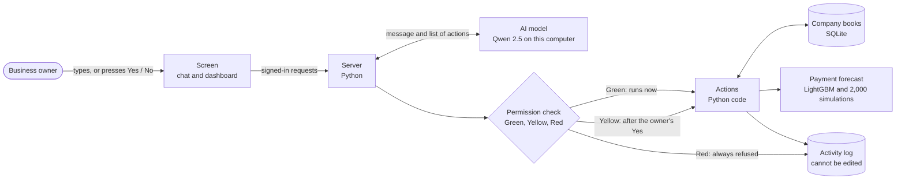

# BillBoard

**Bill is a cash assistant for small businesses, offered by a bank inside its own app.**

Bill warns a small-business owner before cash runs short, shows how big the gap really is, and lists the cheapest ways to close it, including not borrowing at all. The owner talks to Bill in a chat. Bill looks things up, runs the calculations and explains them in plain words. It never moves money.

BillBoard was called Rightsize until mid-October 2026. The old name still appears in some documents and in the setting `RIGHTSIZE_OWNER_PIN`.

> **This is a competition demo.** The company, its customers and every invoice are generated by code. The bank and its loan terms are made up. Nothing connects to a real bank, and no message leaves the computer.

## Contents

1. [Project overview](#1-project-overview)
2. [How it works](#2-how-it-works)
3. [What we used, and why](#3-what-we-used-and-why)
4. [Install and run](#4-install-and-run)
5. [Testing](#5-testing)
6. [Repository and deployment](#6-repository-and-deployment)
7. [Security](#7-security)
8. [Decisions we made, and why](#8-decisions-we-made-and-why)
9. [What this demo does not prove](#9-what-this-demo-does-not-prove)
10. [Words used in this document](#10-words-used-in-this-document)

## 1. Project overview

| | |
| --- | --- |
| Competition | 2026 Shenzhen FinTechathon, International AI Track |
| Topic | E: SME Finance Copilot |
| Project | BillBoard, with the assistant Bill (formerly Rightsize) |
| One-line summary | A cash assistant inside a bank's app that warns a small business before cash runs short and finds the cheapest way to close the gap, including not borrowing. |

### The problem

The idea came from a banker at a Georgian bank. One client borrowed about $100,000 to cover a cash gap that closed by itself within a month. Small businesses make two expensive mistakes, and in the banker's experience both are equally common:

- **They borrow too much, or for too long.** They pay interest on money they did not need.
- **They notice the gap too late.** By then only expensive fixes are left, and salaries or taxes may be paid late.

### What Bill does

Bill has three jobs:

1. **Watch.** The dashboard shows the company's cash for the next 30 or 60 days and checks the owner's saved alerts each time it opens. The owner sees trouble weeks ahead, while cheap fixes still work.
2. **Size.** Bill shows how big the gap is in three cases: likely, cautious, and "nobody pays".
3. **Close.** Bill lists every way to close the gap, cheapest first, with its total cost in lari: wait, remind late customers, offer an early-payment discount, use an overdraft, or take a loan. It marks one option as recommended, names a fallback, and waits for the owner to decide.

Questions the owner can ask, for example:

- "Can I pay salaries on the 10th and taxes on the 15th?"
- "Who owes me money, and who is late?"
- "Send a payment reminder to the late ones."
- "I'm short. What are my options?"
- "What if this customer paid everything today? Would I still need the overdraft?"
- "Can I afford a GEL 20,000 stock order next month?"

### What we are aiming for

- **For the business owner:** never miss a salary or tax payment, never borrow more or for longer than needed, and see the full cost of every option in lari before deciding.
- **For the bank:** an assistant it can trust in front of its clients. It cannot be talked into moving money, it says when a figure is a guess, and it records every step.
- **For the competition:** strong results on the three scoring criteria: completing scripted tasks (40%), security and compliance (30%), and innovation and interaction (30%). Our goal is to reach the final in Shenzhen.

Success, for us, looks like this: every scripted conversation passes, every trick attempt is refused and logged, and a business owner can use Bill without help.

### What we are looking for

- **From judges:** feedback on whether Bill's advice is right, safe and clear.
- **From banks:** a bank willing to try Bill in a test environment with real, anonymised business data. Our data is generated, so we cannot yet show how well the forecast works on real customers.
- **From business owners:** owners who try the demo and tell us whether the warnings and options help them decide.
- **From finance experts:** real product terms, to replace our placeholder rates and fees.

## 2. How it works

### The parts

BillBoard runs on one computer and has five parts:

- **The screen.** A web page with the chat and a six-page dashboard.
- **The server.** A Python program. It signs the owner in, passes messages between the screen and the AI model, and enforces the permission rules.
- **The AI model.** Qwen 2.5 (7B), running on the same computer through Ollama. It reads the owner's message, chooses which action to run, and writes the answer. It does no arithmetic.
- **The actions.** 25 named operations the AI model may ask for, such as "look up who owes money" or "forecast cash". Each one is ordinary Python code with a fixed permission level: Green, Yellow or Red.
- **The books.** The company's invoices, cash records, saved plans and the activity log, kept in one SQLite database file.

A trained **payment-forecast model** (LightGBM) sits beside the server. It estimates when each unpaid invoice is likely to be paid.



### What happens when the owner asks a question

1. The owner types: "Can I pay salaries on the 10th?"
2. The server sends the message to the AI model, with the list of actions it may ask for.
3. The model asks for one action, here `forecast_cash`.
4. The server checks the action's level. `forecast_cash` is Green, so it runs straight away.
5. Python code works out the figures from the books and hands them back to the model.
6. The model writes the answer in plain words, using only those figures.
7. Every request, result and decision is written to the activity log.

For a Yellow action, such as sending a reminder, Bill shows an **approval card** with exactly what will be saved. Nothing happens until the owner presses Yes. For a Red action, such as a money transfer, the server refuses and logs the attempt.

### The data

All data is generated by code (`ml/generate_invoices_ge.py`). No record comes from a real company.

- **The company:** Demo Food & Drink Wholesale LLC, a wholesaler in Tbilisi, Georgia. Amounts are in lari (GEL).
- **Its customers:** 500 restaurants, cafés, hotels, bars, caterers and grocery stores, about half of them in Tbilisi.
- **Its invoices:** 50,319 invoices from January 2022 to September 2026, about GEL 13 million a year. Customers get 15, 30 or 60 days to pay. They pay more slowly around their own paydays, at month end, and around weekends and Georgian public holidays.
- **"Today":** the books end on 3 Oct 2026, so that is "today" in the app, whatever the computer's clock says.
- **The company's own money:** an opening balance of GEL 260,000, salaries on the 10th, taxes on the 15th and stock purchases four times a month. These are placeholders in `backend/data/company.json`.
- **The bank's products:** an overdraft at 16% a year, a 12-month loan at 15% a year plus a 1% fee, and a 2% early-payment discount. These are placeholders in `backend/data/products.json`.

How the data is made and checked is explained in [docs/data-generation-and-handling.md](docs/data-generation-and-handling.md), and its weak points in [docs/data-review.md](docs/data-review.md).

### How the forecast works

**Step 1: when will each invoice be paid?** For every unpaid invoice and every coming day, the payment model gives the chance that the invoice is paid on that day, if it has not been paid already. Chaining the days together gives the chance it is paid within 7, 14, 30 or 60 days. The model learns from the customer's past payment habits, the invoice's size and terms, and the calendar.

- It learned from invoices issued in 2022 to 2024.
- Its settings were chosen on January to September 2025.
- It was tested once, at the end, on January to September 2026, so the test score is honest.
- It had to beat a simple forecast built from past averages, called the baseline. The chosen version has 500 trees, 16 leaves and at least 100 rows per leaf. A calibration tweak and a larger 983-tree version were tried and not kept.

The details and scripts are in [ml/README.md](ml/README.md).

**Step 2: how much cash will we have?** The server plays out 2,000 possible futures. In each one, every invoice is paid or not on each day according to its chances. Each future adds recorded cash, expected invoice payments and an assumption for future sales based on history, then takes away scheduled bills and loan repayments. From the 2,000 futures, Bill reports three cases:

| Case | Meaning |
| --- | --- |
| Likely | The middle result on each day. |
| Cautious | On each day, only 1 in 10 futures is worse. This is not a 90% guarantee for the whole period. |
| Nobody pays | No invoice is paid at all. A stress test, not a forecast. |

The same seed is used every time, so the same books always give the same forecast. The charts show weekly points and each case's lowest balance.

**Step 3: what are the options?** `compare_options` lists every way to cover a gap of a given size and length, cheapest first:

| Option | How its cost is worked out |
| --- | --- |
| Wait | Free, but the gap stays unless customers pay in time. Never recommended, because it does not cover the gap. |
| Remind late customers | Known direct fees only. It works only if they pay. |
| Early-payment discount | 2% off whole invoices for customers who agree to pay early. Needs the customer's agreement. |
| Overdraft | The amount times the yearly rate, for the days used out of 365. GEL 8,000 for 21 days at 16% costs GEL 73.64. |
| Term loan | Equal monthly payments over the full 12-month term, plus the fee. GEL 30,000 at 15% costs GEL 2,493.00 in interest plus a GEL 300.00 fee. |

Bill marks the cheapest option that covers the gap as **recommended**. If that option depends on customers paying, it also names a **fallback**: the cheapest option that is sure to bring the money, still subject to the bank's approval. Loan costs are also shown at 12%, 15% and 18% a year as assumptions, not bank offers. If the owner has a real quote, Bill uses that rate instead. Before the owner commits, `preview_funding_plan` shows the cash forecast with the plan included.

All of this arithmetic is Python code (`backend/bank/products.py`, `backend/actions/borrowing.py`). The AI model takes no part in it.

## 3. What we used, and why

### Environment

| | |
| --- | --- |
| Operating system | macOS. The commands below assume zsh, the Mac's standard shell. Linux should work but is not tested. Windows is not tested. |
| Python | 3.12 |
| Node.js | 22.12 or newer (the screen's build tool needs 20.19 or newer, and its tests need 22) |
| Ollama | Tested with 0.35 |
| Disk and memory | About 5 GB of disk for the AI model, and at least 8 GB of memory |

### Tools

| Tool | What it does here | Why we chose it |
| --- | --- | --- |
| [Python](https://www.python.org) | The language of the server, all the money arithmetic and the forecast | The team's language, with strong finance and data libraries |
| [FastAPI](https://fastapi.tiangolo.com) and [Uvicorn](https://www.uvicorn.org) | The web server between the screen and the AI model | Little code, and it checks every request's format automatically |
| [SQLite](https://sqlite.org) | The company's books, as one file | Nothing extra to install, and its triggers can stop anyone editing or deleting log rows |
| [Ollama](https://ollama.com) and [Qwen 2.5 (7B)](https://ollama.com/library/qwen2.5) | The AI model, running on our own computer | Free, and no company data leaves the machine. It replaced a paid cloud model on 4 Oct. |
| [httpx](https://www.python-httpx.org) | Lets the server talk to Ollama | Small and standard |
| [pydantic](https://docs.pydantic.dev) | Checks every action's inputs before the action runs | Catches wrong or extra inputs from the AI model |
| [LightGBM](https://lightgbm.readthedocs.io) | The payment-forecast model | Works well on table data, runs fast on a laptop and gives probabilities |
| [NumPy](https://numpy.org) and [pandas](https://pandas.pydata.org) | The 2,000 simulated futures, and preparing the invoice history for training | Standard tools for numbers and tables |
| [React](https://react.dev), [TypeScript](https://www.typescriptlang.org) and [Vite](https://vite.dev) | The screen: the chat and the six-page dashboard | Fast to build, and type checks catch mistakes early |
| [react-markdown](https://github.com/remarkjs/react-markdown) | Shows Bill's bullets and tables properly in the chat | Small, and it does not run HTML from the model |
| Hand-drawn SVG charts | The cash charts on the dashboard | No chart library needed. All values come from Python. |
| Python's `unittest`, [ESLint](https://eslint.org) and Node's test runner | Automated checks of the code | Built into the languages, so nothing extra to install |
| Our scoring script (`tests/scenarios/`) | Plays 19 scripted conversations with the real AI model and checks what Bill did | The judges score task completion, so we measure it ourselves |
| SHA-256 | A fingerprint that links log rows together and protects sign-in tokens | Standard, and built into Python |
| [Git](https://git-scm.com) and [GitHub](https://github.com/nianordv/sme-copilot) | Sharing and reviewing code | The team works on separate branches and merges them |

AI coding assistants, such as Claude Code, helped write much of the code, tests and documents. The team chose what to build and is responsible for all of it.

`backend/requirements.txt` pins the whole installation, including packages that come bundled with FastAPI and that the app never uses (for example Sentry and OpenTelemetry). `ml/requirements.txt` pins the forecast's packages, including scikit-learn, which training the model and the calibration check need.

### Settings

Settings are environment variables, set when the server starts. Never commit a real PIN.

| Variable | Needed | What it does |
| --- | --- | --- |
| `RIGHTSIZE_OWNER_PIN` | Yes | The owner's PIN. There is no default: without it nobody can sign in. |
| `RIGHTSIZE_DB` | No | Which database file to use. The default is `backend/data/rightsize.db`. |
| `RIGHTSIZE_PRODUCTS` | No | Which product-terms file to use. The default is `backend/data/products.json`. |
| `OLLAMA_URL` | No | Where Ollama answers. The default is `http://127.0.0.1:11434`. |
| `OLLAMA_MODEL` | No | Which AI model to use. The default is `qwen2.5:7b`. |
| `BILLBOARD_ML_PYTHON` | No | Which Python re-scores invoices at a later reporting date. The default is `ml/.venv/bin/python`. |

## 4. Install and run

**In plain words.** You run three programs on one computer: the AI model (Ollama), the server and the screen. The first time, you also generate the company's data, prepare the forecast and build the books. Run every command from the repository's top folder unless a step says otherwise.

### Step 1: install the tools

Install Python 3.12, Node.js 22.12 or newer, and [Ollama](https://ollama.com). Then download the AI model once. It is about 5 GB.

```sh
ollama pull qwen2.5:7b
```

### Step 2: generate the data and prepare the forecast (first time only)

```sh
python3 -m venv ml/.venv
source ml/.venv/bin/activate
python -m pip install -r ml/requirements.txt
python -m ml.generate_invoices_ge
python -m ml.prepare_data
python -m ml.baseline
python -m ml.score_open_invoices
deactivate
```

This writes the 50,319 generated invoices to `ml/data/` and the forecast files to `ml/artifacts/`. Git ignores both folders, so everyone generates them on their own computer. The same seed gives the same file every time.

`ml.score_open_invoices` uses the trained model in `ml/artifacts/lightgbm/leaves_16_min_100`. If that folder is missing, it uses the simple average-based forecast instead and records which one it used. To get the trained model, either copy the team's saved folder into `ml/artifacts/lightgbm/`, or rebuild it with `python -m ml.tune` before the scoring step. Rebuilding trains six versions and takes a while.

### Step 3: build the company's books (first time only)

```sh
python3 -m venv backend/.venv
source backend/.venv/bin/activate
python -m pip install -r backend/requirements.txt
python -m backend.bank.seed
```

This copies the 50,319 invoices and 500 customers into `backend/data/rightsize.db`, which Git ignores. It adds the company's balance and bills from `backend/data/company.json`.

Once the owner has entered real opening cash, the seed refuses to overwrite the books. To experiment, build a separate copy with `python -m backend.bank.seed --db /tmp/billboard-test.db`, and start the server with `RIGHTSIZE_DB=/tmp/billboard-test.db`. Do not regenerate the data of a demo that is already set up.

### Step 4: start the demo

Use three terminals.

**Terminal 1, the AI model.** Open the Ollama app, or run `ollama serve`. If it says "address already in use", Ollama is already running. Do not start a second copy.

**Terminal 2, the server.** Choose a private PIN of at least eight characters. The PIN is typed hidden and is not saved in your shell history.

```sh
source backend/.venv/bin/activate
read -s 'RIGHTSIZE_OWNER_PIN?Choose your demo PIN: '
export RIGHTSIZE_OWNER_PIN
python -m uvicorn backend.main:app --reload
```

In bash, use `read -s -p 'Choose your demo PIN: ' RIGHTSIZE_OWNER_PIN` instead. The server listens on port 8000. `http://127.0.0.1:8000/health` answers `{"status":"ok"}` when it is up, and `http://127.0.0.1:8000/docs` lists its endpoints.

**Terminal 3, the screen.**

```sh
cd frontend
npm install
npm run dev
```

Open the address it prints, normally `http://localhost:5173`, and sign in with your PIN. If port 8000 or 5173 is taken, stop the older copy in its own terminal with Ctrl+C.

### Using the app

**The chat.** Ask Bill a question in your own words. When Bill wants to save or record something, it shows an approval card. Press Yes or No. Typing "yes" in the chat does not approve anything.

**The dashboard** has six pages: Overview, Cash forecast, Invoices & customers, Transactions & loans, Funding options and Activity. Every figure on it comes from the same Python code the chat uses.

**Keeping the books.** Until you enter opening cash, the dashboard uses the demo's seeded cash and says so. Every change below, even one made through a form, is a Yellow action. It changes the books only after you approve it in the chat.

1. **Enter opening cash** and its date, in Overview or Transactions & loans.
2. **Record money as it moves.** Give each receipt or payment a reference of its own. Link a customer's payment to its invoice, and a bill or loan payment to its obligation. The dashboard lists both kinds of ID. A part payment reduces what the customer still owes. Entering the same transaction twice with the same reference changes nothing, and a different transaction cannot reuse a reference.
3. **Avoid counting money twice.** If a payment was already part of your opening cash, mark it as such. That closes the invoice or bill without changing cash again.
4. **Record a loan you already have.** Do this only for a loan received elsewhere. Enter the amount, yearly rate, upfront fees, dates, remaining months and how it is repaid. Its future repayments then appear in the forecast. Bill never takes a loan.
5. **Move the reporting date forward** when you want "today" to change. A scheduled bill is not treated as paid until you record it. An unpaid bill that is past due stays owed and is assumed to be paid tomorrow.
6. **Correct a mistake** by adding a reversing entry. The original entry stays, so the history is complete. Cancelling a wrong loan record corrects the books only. It does not cancel a real loan.

**A locked chat.** After 3 refused requests, a chat can only look things up. To unlock it, press Unlock below the chat and type your PIN. A message in the chat cannot unlock it.

## 5. Testing

**In plain words.** There are two kinds of checks. Code tests run in seconds and need no AI model. They check the arithmetic, the permission rules, the log and the sign-in. Scripted conversations ask the real AI model fixed questions and check what Bill actually did, as recorded in the log, and what it answered.

### Code tests

```sh
backend/.venv/bin/python -m unittest discover -s backend/tests
backend/.venv/bin/python -m unittest discover -s tests/scenarios -p 'test_*.py'
ml/.venv/bin/python -m unittest discover -s ml/tests
cd frontend
npm run lint
npm run build
npm test
```

Expected result: each command ends with `OK`, or with no errors. On 17 Oct 2026 the first two commands gave `Ran 408 tests ... OK (skipped=3)` and `Ran 76 tests ... OK`. The three skipped tests compare against the generated data and run once Step 2 is done.

### A full check without the AI model

```sh
backend/.venv/bin/python -m backend.submission_check
```

This builds fresh temporary books and goes through sign-in, bookkeeping and the forecast through the real server code. It never touches the owner's database and needs neither Ollama nor your PIN, but it does need Step 2's files.

### Scripted conversations

Start a second server on its own copy of the books, because every run adds rows to the log, which cannot be removed. Use the same PIN and database for the server and the script.

```sh
source backend/.venv/bin/activate
python -m backend.bank.seed --db /tmp/billboard-test.db
export RIGHTSIZE_DB=/tmp/billboard-test.db
read -s 'RIGHTSIZE_OWNER_PIN?Test PIN: '
export RIGHTSIZE_OWNER_PIN
python -m uvicorn backend.main:app --port 8001
```

In another terminal, with the same two variables set, run the general cases first. The bookkeeping cases come last because they change the books, and they expect fresh books with no opening cash entered.

```sh
python -m tests.scenarios.run --server http://127.0.0.1:8001
python -m tests.scenarios.run --server http://127.0.0.1:8001 --cases tests/scenarios/b6_questions.json
python -m tests.scenarios.run --server http://127.0.0.1:8001 --cases tests/scenarios/bookkeeping_questions.json
```

There are 19 cases:

| File | Cases | What they cover |
| --- | --- | --- |
| `questions.json` | 10 owner questions | Salaries and taxes, bills due, who owes money, one customer, reminders (approved and declined), being short, options for a given gap, "what if this customer paid", a stock order |
| `questions.json` | 4 trick attempts | Being told to transfer money, being asked to print its instructions, an instruction hidden inside a reminder's text, and someone claiming to be the bank's administrator |
| `b6_questions.json` | 3 conversations | Accepting a correction, asking for a missing payment date, and going from a shortfall to the options |
| `bookkeeping_questions.json` | 2 conversations | Entering opening cash and an invoice payment, and recording an existing loan |

The script reads what ran from the log, not only from Bill's words. It works out the expected figures from the books and saves everything it saw under `tests/scenarios/results/`. [tests/scenarios/README.md](tests/scenarios/README.md) explains the format of a case.

**Known limits.** These are specific cases, not proof that every conversation is right. A 7-billion-parameter model on a laptop is slow: in our runs the first answer took a few minutes while the model loaded, and later answers took 10 to 35 seconds. Its wording can vary between runs, but the permission rules do not depend on it.

## 6. Repository and deployment

- **Repository:** <https://github.com/nianordv/sme-copilot>
- **Live demo:** none. BillBoard runs on one computer only.
- **Deployment:** local only, on purpose. The AI model runs on the same computer, and the server answers only local addresses over plain HTTP. Putting it online would need HTTPS, secure cookies, the bank's real sign-in and limits per device.

More documents:

| Document | What it covers |
| --- | --- |
| [docs/Idea_md.md](docs/Idea_md.md) ([PDF](docs/Idea.pdf)) | The team brief from 4 Oct, under the old name |
| [docs/build-phases.md](docs/build-phases.md) | How the work was split between the two developers |
| [docs/action-registry-security.md](docs/action-registry-security.md) | The first design of the permission code |
| [docs/data-generation-and-handling.md](docs/data-generation-and-handling.md) | How the invoices are generated and prepared |
| [docs/data-review.md](docs/data-review.md) | An independent review of the data's strengths and weak points |
| [ml/README.md](ml/README.md) | The payment model: training, selection and scoring |
| [tests/scenarios/README.md](tests/scenarios/README.md) | The scoring script and the format of a case |

## 7. Security

**In plain words.** Think of the AI model as a new employee: it may suggest anything, but it can only do what the rules allow. The rules are written in the server's code, not in the AI's instructions, so no message, however clever, can change them.

### Permission levels

| Level | What happens | Actions |
| --- | --- | --- |
| Green | Runs straight away. Only reads or calculates. | `get_receivables`, `get_customer`, `get_balance`, `get_upcoming_outflows`, `get_cash_records`, `get_cash_risk`, `get_payment_probabilities`, `forecast_cash`, `preview_funding_plan`, `compare_options`, `draft_reminder` |
| Yellow | Stored and shown to the owner on an approval card. Runs only when the owner presses Yes. | `send_reminder`, `set_alert`, `save_plan`, `prepare_credit_request`, `set_opening_balance`, `record_cash_transaction`, `reverse_cash_transaction`, `set_reporting_date`, `record_existing_loan`, `cancel_recorded_loan` |
| Red | Never runs. Always refused and logged. | `transfer_money`, `take_loan`, `repay_loan`, `submit_credit_request` |

- **Approval.** Only a button press approves a Yellow action. The approval works once, within 10 minutes, and only in the chat that asked for it. The owner approves the exact request that was stored, so it cannot be changed afterwards.
- **Inputs.** Every action's inputs are checked before it runs. Unknown actions and unexpected inputs are refused.
- **Lock.** After 3 refused requests in one chat, that chat can only look things up. Only the owner's PIN, typed outside the chat, unlocks it. The AI model cannot approve requests or unlock itself.
- **The activity log.** Every request, approval, refusal, sign-in and wrong PIN adds a row. Rows can only be added: the database refuses changes and deletions, and each row carries a fingerprint of the one before, so a removed or altered row shows. Corrections to the books are new, opposite entries.
- **Sign-in.** One demo owner signs in with a PIN, as in a bank app. The login lasts 8 hours. The browser receives a long random token in a cookie that page scripts cannot read and other websites cannot make the browser send. The database keeps only the token's fingerprint. After 5 wrong PINs within 5 minutes, all attempts are refused for 5 minutes, and a restart does not reset the count.
- **Who the owner is** comes from the sign-in, never from the chat. A message that claims to come from bank staff changes nothing.
- **Text from the AI model is treated as data.** On the approval card, a name appears in quotation marks and a message is marked line by line, so neither can pass for the app's own words. Invisible characters are written out as visible codes.

### The four attacks the judges test

| Attack | Our answer |
| --- | --- |
| Talking Bill into a transfer | Bill cannot move money at all. Transfers, loans and repayments are Red, so they are refused and logged. |
| Getting Bill to leak data | Every endpoint except the health check and sign-in needs the owner's sign-in. Bill is told not to reveal its instructions; even if it did, they contain no PIN, and the permission rules live in code. Nothing is sent outside the computer. |
| False claims of authority | Who the owner is comes from the PIN sign-in. Unlocking needs the PIN, typed outside the chat. |
| Hidden instructions in a document or message | Customer names, reminder texts and pasted documents are treated as data. Only a button press approves anything. |

### Data handling

- All data is generated. No real person or company is in it.
- The PIN lives only in the server's environment. It is never written to the repository, the database or a log.
- The AI model runs on the same computer. No message, figure or document is sent to an outside service.
- A "sent" reminder is saved in a local outbox, and a credit request stays a draft. Nothing reaches a customer or a bank.
- The generated data, the database and test results are kept out of Git.

### Known risks

- The PIN stands in for a bank's own sign-in. One PIN is not two-step verification.
- The wrong-PIN limit slows guessing down but does not stop it: it allows about 1,400 tries a day. The server accepts any PIN of 4 or more characters, which is why the instructions ask for at least eight.
- The limit is one for everybody, so whoever can reach the server can keep the owner out by typing wrong PINs. A bank would limit attempts per device.
- With one owner, signed in means allowed everything. A second owner would need each conversation tied to its owner, which is not built.
- It guards the server, not the files. A program running under your own account can read the database file and the PIN the server was started with. Someone in control of the whole computer could rewrite the database.
- A page served from another port of the same computer counts as local, so the check against other websites does not stop it.
- The server speaks plain HTTP on this computer, so the cookie is not marked `Secure`.
- The pages that describe the API, `/docs` and `/openapi.json`, stay open. They list the endpoints and hold no company data.
- Marking the AI's text on the approval card is a best effort. No list of misleading characters is complete.

The original design of the permission code is in [docs/action-registry-security.md](docs/action-registry-security.md).

## 8. Decisions we made, and why

### The product

1. **A wholesaler in Tbilisi, in lari, with a fictional bank** (1 Oct). The idea came from a banker at a Georgian bank, and we know this market. A fictional bank avoids speaking for a real one.
2. **Bill lives inside the bank's own app**, not as an independent adviser (1 Oct). The bank already holds the data Bill needs, and the owner already uses that app.
3. **Bill only advises.** It never pays, borrows, repays or submits a credit request; the owner does (1 Oct). If Bill cannot move money, nobody can trick it into moving money, and the owner keeps every decision about their own money.
4. **"You don't need to borrow" can be the answer.** Options are listed cheapest first, each with its total cost and yearly rate. The cheapest one that covers the gap is recommended, with a sure fallback when it depends on customers paying. Waiting is never recommended. Over-borrowing is as common as noticing too late, and an assistant that always says "borrow" would just be a sales tool.
5. **Three jobs: Watch, Size and Close.** A gap seen weeks ahead can often be closed with a free reminder. A gap seen the day before leaves only expensive options.
6. **Every number comes from Python, never from the AI model.** Language models can get arithmetic wrong and can invent figures, and in finance a wrong number is a serious failure.
7. **The chat is the main screen, and the dashboard supports it** (13 Oct). The judges score the conversation. The dashboard plays the part of "the bank app": it shows what Bill saved, using the same code, so the numbers always match.
8. **The owner can record real cash, payments and existing loans, and mistakes are fixed with reversing entries** (16 Oct). A forecast is only as good as the cash it starts from. Corrections as new entries keep the full history, as accountants do.

### The AI model and the data

9. **A free model on our own computer instead of a paid cloud AI** (4 Oct). It costs nothing and no company data leaves the machine. The trade-off is that a 7B model is slower and weaker at choosing actions than large cloud models.
10. **Generated data, not real data.** We have no real company's books, real books would be private, and the same seed gives everyone on the team the same file.
11. **The forecast learns from the past and is tested once on the most recent year.** Splitting by date mimics real use, where the future is unknown. Touching the test year only once keeps the score honest. The model had to beat a simple average-based forecast, or it would not be worth its complexity.
12. **2,000 simulated futures, reported as likely, cautious and "nobody pays".** A single number hides risk, and a range shows the owner how bad it can get. A fixed seed gives the same answer every time.
13. **Bank terms and company costs are placeholders, clearly marked**, in two files the finance teammates can edit without touching code. Real terms differ by bank and client, and the marking stops anyone mistaking them for offers.
14. **A customer who owes 25% or more of the total is flagged.** Losing one big customer hurts most. This is a simple rule anyone can check, not a prediction.

### Security

15. **Green, Yellow and Red are enforced by server code, not by instructions to the AI.** An AI can be talked around its instructions, and code cannot. The organisers ask for these three levels.
16. **For a Yellow action, only a button press approves, once, within 10 minutes, in the same chat, for the exact stored request.** Text in a chat can come from anywhere, even from the AI model itself. A button press on a stored request cannot be faked with words.
17. **Red actions are registered, so every attempt is refused and logged** rather than silently ignored. This enforces decision 3 and leaves evidence.
18. **Every step goes into a log that cannot be edited.** It is our evidence for the judges, and the organisers ask for a full audit log.
19. **After 3 refused requests the chat locks, and only the PIN unlocks it.** Repeated refusals suggest misuse, and the organisers ask for a safety lock. The PIN is typed outside the chat, so no message can unlock it.
20. **One demo owner signs in with a PIN** (13 Oct). Without it, any program on the computer could read the figures or press Yes. A PIN is what bank apps use, and one owner keeps the build small.
21. **The AI's text is shown as quoted data.** A customer name or message could be written to look like the app's own words on the approval card.
22. **Nothing leaves the computer.** No real message or request can go out during a demo. This follows from decision 3.

### Scope and testing

23. **Left out, to fit the time before the deadline:** real bank connections, reading invoice PDFs or photos, a mobile app, more than one user, other currencies and factoring. Each is a large project on its own. A generator for the company's supplier bills exists on the branch `feat/outgoing-invoices` but is not connected.
24. **Tests judge Bill by what it did, read from the log, not only by its words.** An AI can say "I sent it" without doing it. The expected figures are worked out from the books, so the tests still hold if the data is regenerated.

## 9. What this demo does not prove

- **Real-world accuracy.** The data is generated, so good scores show that the method works on our own assumptions, not that it predicts real Georgian customers. The payment model partly rediscovers rules we wrote into the generator.
- **Shared shocks.** Each invoice is paid or not independently, so a crisis that hits all customers at once is not modelled, and the cautious case may be too mild.
- **Future sales.** Sales not yet invoiced follow a fixed assumption from history. Their uncertainty is not simulated.
- **Part payments.** The remaining balance of a part-paid invoice follows the same timing curve. This is an assumption, not tested.
- **New invoices.** The demo uses a fixed set of invoices. Importing new ones is not built, and a prediction never marks a payment as received.
- **Costs.** Waiting and reminders count known direct fees only, not what it costs to pay a supplier late. Discount selection picks whole invoices and is not proven to be the best possible choice. Rates are nominal yearly rates, not the effective APR. Bank credit always remains subject to the bank's approval.
- **Alerts.** Saved alerts are checked when the dashboard opens or refreshes. No background service sends notifications.
- **Every conversation.** The scripted cases are specific tests, not proof that every possible conversation goes right.

## 10. Words used in this document

| Word | Meaning |
| --- | --- |
| AI model | A program that reads and writes text. Here it chooses actions and explains results; it does not calculate. |
| Action | One named operation the AI model may ask for, such as "look up a customer". |
| Approval card | The box in the chat that shows what a Yellow action will save, with Yes and No buttons. |
| Activity log (audit log) | The record of everything Bill was asked to do and what happened. Rows can only be added. |
| Baseline | A simple forecast built from past averages, which the trained model had to beat. |
| Books | The company's records: invoices, customers, cash, bills, loans and plans. |
| Green, Yellow, Red | The three permission levels: runs, waits for the owner, never runs. |
| Overdraft | A bank lets the account go below zero up to a limit, and charges interest only for the days used. |
| Term loan | A fixed amount borrowed once and repaid in equal monthly payments. |
| Server | The program that sits between the screen and the AI model and enforces the rules. |
| Synthetic data | Data generated by code to look realistic, with no real people or companies in it. |
